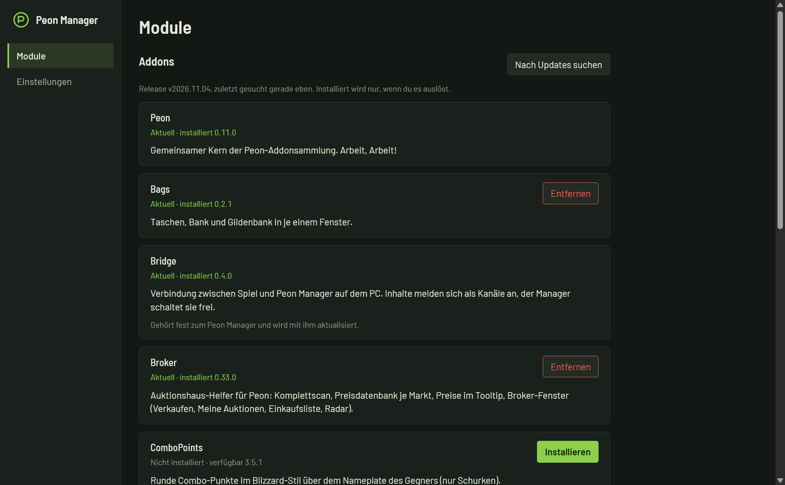

  

<h1 align="center">Peon</h1>

  <strong>Arbeit, Arbeit!</strong> 
  Addons für World of Warcraft Forever, dazu ein kleines Windows-Programm, das sie für dich installiert und aktuell hält.

  
  
  
  
  

  <a href="https://github.com/KarloDerBaer/peon/releases/latest"><strong>⬇️ Peon Manager herunterladen</strong></a>
  &nbsp;·&nbsp;
  <a href="#-installation">Installation</a>
  &nbsp;·&nbsp;
  <a href="#-feedback-und-fehler">Fehler melden</a>
  &nbsp;·&nbsp;
  <a href="https://buymeacoffee.com/karloderbaer">Kaffee spendieren</a>

  

> [!NOTE]
> Peon ist noch jung. Die Addons sind mit einem Nachbau des Spiels getestet und bis zum Ende der Beta im Spiel gelaufen. Nach dem Start von Forever kann es noch Fehler geben. [Rückmeldungen](#-feedback-und-fehler) helfen sehr.

## 🧩 Die Addons

Alle Teile hängen an einem gemeinsamen Kern und haben ihre Einstellungen unter **Einstellungen > AddOns > Peon**. Sie sind für den deutschen Client gemacht (Interface 16001).

| Addon | Was es tut | Befehl |
|---|---|---|
| **Peon** | Gemeinsamer Kern. Wird von allen anderen gebraucht. | `/peon`, `/peon list` |
| **Peon_Tooltip** | Tooltip folgt der Maus, mit Größe, Transparenz, Rahmenfarbe, PvP- und Quest-Symbol und Kampfmodus. Teile im Gegenstands-Tooltip lassen sich sortieren und ausblenden. | `/ttp` |
| **Peon_Broker** | Helfer fürs Auktionshaus: Komplettscan, Preise je Markt, Preise im Tooltip, eigenes Fenster mit Verkaufen, Meine Auktionen, Einkaufsliste und Radar. | `/broker` |
| **Peon_Ledger** | Bestand aller Charaktere (Taschen, Bank, Post, Auktionen, Gold) und Buchführung über Einnahmen und Ausgaben. | `/ledger` |
| **Peon_Bags** | Taschen, Bank und Gildenbank in je einem Fenster mit Suche und Sortierung. | `/peon bags` |
| **Peon_Fishing** | Angelmodus mit Ausrüstungswechsel, Angeln per Doppelklick oder Taste, Köder, Warnton. | `/fp` |
| **Peon_Feedback** | Fehler und Ideen direkt im Spiel festhalten, der Peon Manager sendet sie weiter. Optional. | `/feedback` |
| **Peon_Mover** | Fenster von Blizzard und Peon verschieben und in der Größe ändern. | `/peon mover` |
| **Peon_Panel** | Leiste und verschiebbares Panel für die Symbole der Peon-Addons, mit kurzen Texten wie Gold oder freien Taschenplätzen. | `/peon panel` |
| **Peon_ComboPoints** | Runde Combo-Punkte über dem Namensschild des Gegners (nur Schurken). | `/peon combopoints` |

Jedes Addon außer Peon ist freiwillig. Nimm nur, was du willst, aber **Peon selbst muss immer dabei sein**.

Peon_Bridge (Verbindung zum Peon Manager) gehört zum Manager und wird mit ihm installiert. Ohne den Manager tut es nichts.

## 🚀 Installation

Am einfachsten geht es mit dem **Peon Manager**. Er installiert und aktualisiert die Addons und hält sich selbst aktuell.

1. Öffne die Seite [Releases](https://github.com/KarloDerBaer/peon/releases/latest) und lade `PeonManager-Setup-….exe`.
2. Starte die Datei. Administratorrechte brauchst du nicht.
3. Der Manager sucht deinen WoW-Ordner und schlägt die Addons vor. Wähle ab, was du nicht willst, und klicke auf **Installieren**. Findet er WoW nicht, wählst du den Ordner `_forever_` selbst aus.
4. Starte WoW. In der Addonliste stehen die Peon-Module eingerückt unter Peon. Im Chat zeigt `/peon list`, was geladen ist.

> [!IMPORTANT]
> **Windows warnt beim ersten Start** („Der Computer wurde durch Windows geschützt“), weil das Programm nicht digital signiert ist. Klicke auf **„Weitere Informationen“** und dann auf **„Trotzdem ausführen“**.

Neue Versionen zeigt der Manager unter **Module** an, installiert wird erst, wenn du auf **Aktualisieren** klickst. Läuft WoW dabei, reicht danach meist `/reload`, neue Dateien brauchen einen Neustart von WoW.

### Peon Broker Client

Unter **Module** kannst du zusätzlich den **Peon Broker Client** installieren. Er sammelt die Auktionsdaten von Broker, wertet sie aus (Verlauf, Chancen, Absatz) und gibt Broker bessere Preise zurück. Broker funktioniert auch ohne ihn.

<strong>Ohne den Manager installieren</strong>

 

Die Addons gehen auch von Hand: Lade auf der Seite [Releases](https://github.com/KarloDerBaer/peon/releases/latest) die Zip-Dateien, die du möchtest (**Peon** brauchst du immer), schließe WoW und entpacke sie nach `<WoW>\_forever_\Interface\AddOns`. Danach liegt dort für jedes Addon ein eigener Ordner, z. B. `AddOns\Peon`. Zum Aktualisieren den alten Ordner löschen und neu entpacken, deine Einstellungen liegen in `WTF` und bleiben erhalten.

## 🐞 Feedback und Fehler

Fehler, Wünsche und Ideen meldest du am einfachsten im **Peon Manager** unter „Rückmeldungen“. Ein Konto brauchst du dafür nicht. Der Manager sammelt auch die Fehler der Addons, du kannst Notizen ergänzen und vor dem Senden alles ändern oder löschen. Im Spiel geht es zusätzlich mit dem Addon Peon_Feedback über `/feedback`.

## ☕ Peon unterstützen

Peon ist kostenlos. Wenn es dir beim Spielen hilft, freue ich mich über einen Kaffee!

## 🛠️ Für Entwickler

Der Code liegt in `addons\`, die Tests in `tests\` (Lua 5.1 mit nachgebauter WoW-Schnittstelle), das Programm in `manager\` und die Doku in `docs\`. Einstieg: [docs/README.md](docs/README.md).

## 📄 Lizenz

MIT, siehe [LICENSE](LICENSE).
